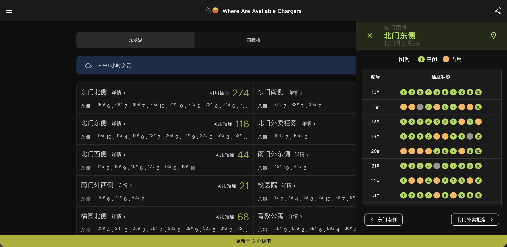
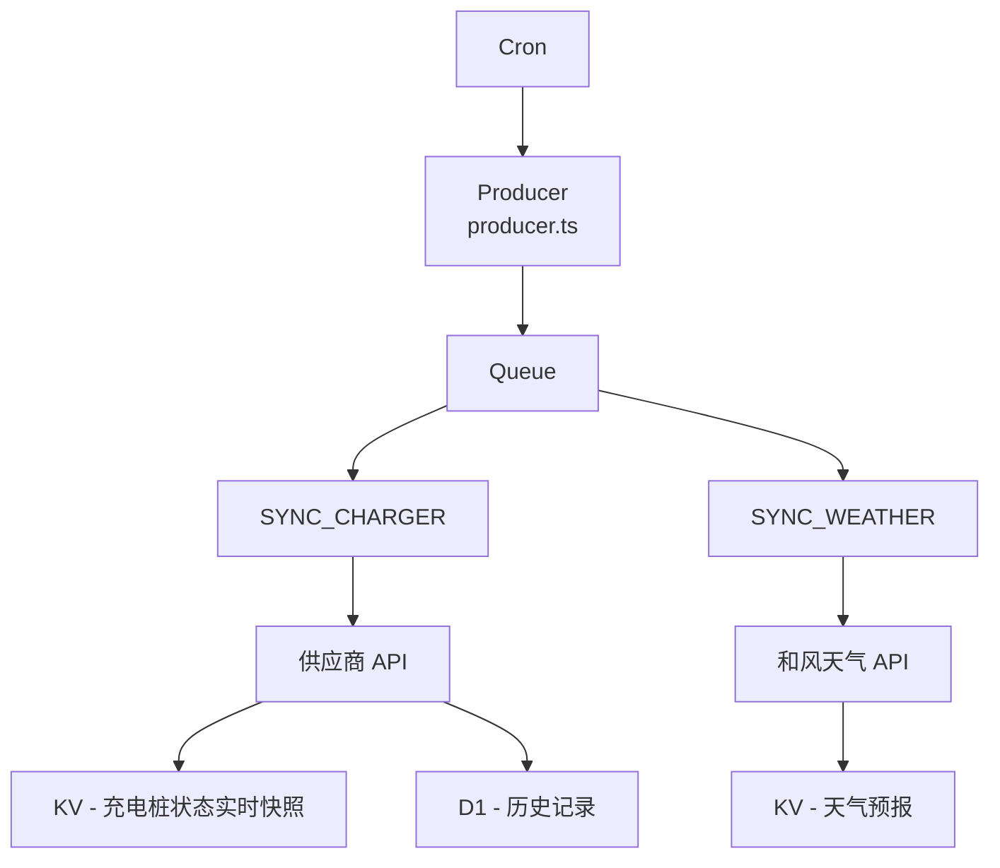

# :electric_plug::rage: Where Are Available Chargers

<https://chargers.dpdns.org> | <https://chargers.injs.eu>

## :page_facing_up: 简介

本项目开始于 2022 年 11 月，初衷是为了帮助 SEUers 更便捷地找到空闲充电桩，可在[关于页面](https://chargers.dpdns.org/about)查看更多信息。如果它对您有帮助的话，可以点击右上角的 ⭐Star 按钮，感谢您的支持 :tada::tada::tada:

当前版本为 _Version 5_

> [!IMPORTANT]
> 目前校内充电桩已不紧缺，并且学校也在 "云游东南" 上线了查询服务。所以将此仓库归档，网站将继续运行



## :building_construction: 架构

本项目采用前后端分离的架构，包含两个子应用：

| 应用     | 路径          | 技术栈                  | 功能                                               |
| -------- | ------------- | ----------------------- | -------------------------------------------------- |
| `web`    | `apps/web`    | Vue 3 + Vuetify + Pinia | 用户界面，充电桩状态查询、历史数据可视化、天气展示 |
| `worker` | `apps/worker` | Cloudflare Workers      | 后端 API、数据采集调度、静态资源托管               |

### 数据流

系统通过定时任务自动采集充电桩和天气数据，核心流程如下：



### 部署架构

Cloudflare Worker 同时承担 API 服务和静态资源托管：

- `/api/*`、`/classic`、`/.well-known/*` 路由优先由 Worker 处理
- 其余请求返回 `apps/web/dist` 中的静态文件，SPA 模式回退

```plaintext
Cloudflare Worker
  ├── /api/*         -> Worker 逻辑（读取 KV/D1）
  ├── /classic       -> SSR 渲染 HTML
  ├── /.well-known/* -> Discovery 端点
  └── /*             -> 静态资源 (web/dist)，SPA fallback
```

## :link: API 文档

<https://chargers.dpdns.org/docs>

## :cloud: 部署到 Cloudflare Workers

### 1. 前端准备

```bash
# 安装依赖
pnpm install  # 或其他包管理器

# 准备环境变量，按实际情况填写（在后续构建时会注入到前端代码中）
cp apps/web/.env.example apps/web/.env.production
```

### 2. 创建 KV、D1、Queue 资源

```bash
cd apps/worker
```

删除 [wrangler.jsonc](apps/worker/wrangler.jsonc) 中的 `kv_namespaces` 和 `d1_databases` 配置，然后执行以下命令：

```bash
wrangler kv namespace create seu-chargers-kv --update-config=true --binding=seu_chargers_kv
wrangler d1 create seu-chargers-d1 --update-config=true --binding=seu_chargers_d1
wrangler d1 execute seu-chargers-d1 --remote --file=./schema.sql
wrangler queues create seu-chargers-queue
```

命令将自动更新 [wrangler.jsonc](apps/worker/wrangler.jsonc) 中的配置。

### 3. 配置 Secrets

```bash
wrangler secret put ZWC_API_URL # 供应商接口（中网充）
wrangler secret put WEATHER_API_URL # 和风天气接口
wrangler secret put WEATHER_API_KEY # 和风天气 API Key
```

如果没有在 Cloudflare 配置对 ZWC_API_URL 的代理和访问控制，则**不需要**填写以下 CF Access 的 Client ID 和 Client Secret：

```bash
wrangler secret put CF_ACCESS_CLIENT_ID
wrangler secret put CF_ACCESS_CLIENT_SECRET
```

充电桩和天气数据的拉取频率由 cron 表达式控制，修改 [wrangler.jsonc](apps/worker/wrangler.jsonc) 中的 `triggers.crons` 即可。经典页面中「访问主站」的跳转地址在 `vars.MAIN_SITE_URL` 中配置。

### 4. 部署 Worker

回到项目根目录，执行：

```bash
pnpm deploy
```

会构建前端（产物在 `apps/web/dist`）并部署 Worker

### 5. 帮助

- 如果需要手动触发，可以到 `Queues` - `消息` - `发送消息`，内容类型选 JSON，正文填写：
  - `{ "type": "SYNC_CHARGER" }` - 触发拉取充电桩状态数据
  - `{ "type": "SYNC_WEATHER" }` - 触发拉取天气预报数据
- 上游供应商 API 若为 IP 而非域名时，拉取时可能会被 Cloudflare 阻止。可以通过添加 DNS 解析来解决，为避免滥用，建议配置访问控制

## :hammer_and_wrench: 开发

### 前端环境变量

复制 `apps/web/.env.example` 为 `apps/web/.env.local`，按需填写：

| 变量                        | 默认值                               | 说明                                                                            |
| --------------------------- | ------------------------------------ | ------------------------------------------------------------------------------- |
| `VITE_USE_MOCK`             | `false`                              | 设为 `true` 启用前端 Mock 数据，无需启动后端                                    |
| `VITE_API_URL`              | `/api`                               | 后端 API 地址。开发环境走 proxy 不需要填；跨域部署时填写完整地址                |
| `VITE_TENCENT_MAP_KEY`      | —                                    | 腾讯位置服务 API Key（[申请](https://lbs.qq.com/dev/console/application/mine)） |
| `VITE_TENCENT_MAP_APP_NAME` | —                                    | 腾讯位置服务 AppName                                                            |
| `VITE_SURVEY_URL`           | —                                    | 反馈问卷地址                                                                    |
| `VITE_CONTACT_EMAIL`        | —                                    | 联系邮箱                                                                        |
| `VITE_CLASSIC_VER_URL`      | `https://chargers.dpdns.org/classic` | 旧版页面地址                                                                    |
| `VITE_SITE_URL`             | `https://chargers.dpdns.org`         | 当前本站地址（分享菜单用）                                                      |

未填写的变量会使用 `src/config.ts` 中的默认值。开发环境下前端会自动缩短轮询间隔（5 秒刷新、2 秒检查后端更新），便于调试。

如果需要连接后端服务，处理跨域问题，可以在 `vite.config.ts` 中配置代理：

```ts
server: {
  proxy: {
    '/api': {
      target: '<backend-url>',
      ...
    },
  },
},
```

### 后端环境变量

在 `apps/worker/wrangler.jsonc` 的 `vars` 中配置（明文）

| 变量            | 默认值                                                           | 说明                                                         |
| --------------- | ---------------------------------------------------------------- | ------------------------------------------------------------ |
| `USE_MOCK`      | —                                                                | 设为 `true` 时充电桩同步使用本地 mock 数据，不调用供应商 API |
| `ZWC_API_URL`   | `https://zwc-backend.chargers.dpdns.org/getProductByDndx.action` | 供应商 API 地址                                              |
| `MAIN_SITE_URL` | `/`                                                              | 经典页面「访问主站」的跳转地址                               |

需要通过 `wrangler secret put` 设置的敏感配置（见部署章节）：

| 变量                      | 说明                                    |
| ------------------------- | --------------------------------------- |
| `WEATHER_API_URL`         | 和风天气 API 地址                       |
| `WEATHER_API_KEY`         | 和风天气 API Key                        |
| `CF_ACCESS_CLIENT_ID`     | （可选）Cloudflare Access Client ID     |
| `CF_ACCESS_CLIENT_SECRET` | （可选）Cloudflare Access Client Secret |

通过以下命令可以在本地触发定时任务：

```bash
curl "http://localhost:8787/cdn-cgi/handler/scheduled"
```

### 前后端联调

如果需要同时启动前后端进行联调，可以在两个终端分别执行：

```bash
# 终端 1：启动后端（Cloudflare Workers 本地开发服务器，端口 8787）
pnpm dev:worker

# 终端 2：启动前端（端口 3000）
pnpm dev:web
```

Vite 已内置 proxy 配置，开发时 `/api` 请求自动转发到 `http://localhost:8787`，无需额外设置。

### 代码规范

```bash
pnpm lint:web     # 前端 lint
pnpm lint:worker  # 后端 lint
pnpm format:web   # 前端格式化
pnpm format:worker # 后端格式化
```

## :scroll: 使用许可

本项目 Ver 3 及后续版本采用 AGPLv3 许可证。

[GNU AFFERO GENERAL PUBLIC LICENSE, Version 3](https://www.gnu.org/licenses/agpl-3.0.html)

```plaintext
Copyright (C) 2022 - Present Gol3vka, Csimide, and other contributors

This program is free software: you can redistribute it and/or modify it under the terms of the GNU Affero General Public License as published by the Free Software Foundation, either version 3 of the License, or (at your option) any later version.

This program is distributed in the hope that it will be useful, but WITHOUT ANY WARRANTY; without even the implied warranty of MERCHANTABILITY or FITNESS FOR A PARTICULAR PURPOSE. See the GNU Affero General Public License for more details.

You should have received a copy of the GNU Affero General Public License along with this program. If not, see <https://www.gnu.org/licenses/>.
```

- `apps/web/public/favicon.svg` 来自 [Google Fonts - Noto Emoji](https://github.com/googlefonts/noto-emoji)，该项目的 Emoji 图像按 [Apache license, version 2.0](http://www.apache.org/licenses/LICENSE-2.0) 授权。

- `apps/web/public/apple-touch-icon.png` 采用 [CC BY-NC-SA 4.0](https://creativecommons.org/licenses/by-nc-sa/4.0/) 许可证。

- `apps/web/public/img/illustration.webp` 采用 [CC BY-NC-SA 4.0](https://creativecommons.org/licenses/by-nc-sa/4.0/) 许可证。
